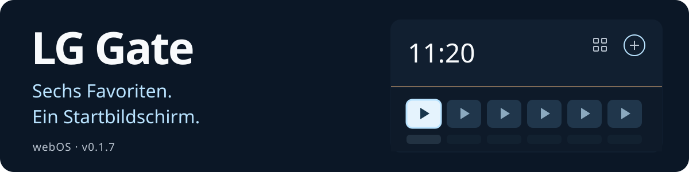

# LG Gate

<p align="center">
  <a href="README.md"></a>
  <a href="README.en.md"></a>
  <a href="README.zh-CN.md"></a>
  <a href="README.ja.md"></a>
  <a href="README.de.md"></a>
</p>

<p align="center">
  
</p>

Ein Startbildschirm für LG webOS mit sechs Lieblings-Apps, Navigation per Fernbedienung und lokal gespeicherten Hintergrundbildern zur Auswahl.

[**0.1.7 herunterladen**](dist/org.lggate.launcher_0.1.7_all.ipk?raw=true) · [Installation und Rücknahme der Änderungen (Russisch)](docs/INSTALLATION.md) · [SHA256](dist/SHA256SUMS.txt)

> [!WARNING]
> **Nur auf dem LG SM8200PLA getestet.**
> Firmware **05.40.97** · webOS **4.10.2 (Generation 4.5)** · Homebrew Channel **0.7.3**.
>
> **Die Kompatibilität mit anderen Modellen und Versionen ist nicht bestätigt.** Installiere die IPK-Datei und verwende die Skripte erst nach einer gesonderten Kompatibilitätsprüfung.


Die Screenshots stammen aus der Browser-Vorschau mit Beispiel-Apps und der ursprünglichen russischen Oberfläche. Auf dem Fernseher verwendet der Launcher dessen eigenen App-Katalog.

## Neu in 0.1.7

Sieben neue Hintergründe und eine Auswahl mit Miniaturansichten und direkter Vorschau. Das Panel öffnet sich über der rechten Seite des Launchers; Größe und Position von Uhr und App-Kacheln bleiben erhalten. Diese Version wurde auf dem LG SM8200PLA installiert. Alle 35 Anwendungsdateien wurden per SHA256 geprüft.

## Funktionen

- **Startbildschirm:** bis zu sechs App-Kacheln zum Anheften, Ersetzen und Umsortieren.
- **App-Katalog:** auf dem Fernseher installierte Apps und unterstützte Verknüpfungen von Media Station X.
- **Zurück zum Startbildschirm:** Home-Taste, Autostart und Rückkehr nach dem vollständigen Beenden einer App.
- **App-Tasten:** IVI → YouTube und Movies/Rakuten → Zona lassen sich getrennt konfigurieren.
- **WLAN, seit 0.1.5:** öffnet die LG-eigene Netzwerkliste. Netzwerkauswahl und Passworteingabe erfolgen in den Einstellungen des Fernsehers.
- **Darstellung:** 12 lokale Hintergründe, schwarzer Bildschirm, Animationen, an die Oberfläche angepasste Spiegelungen und Abdunklung.

## Hintergrund auswählen

Unter **Einstellungen → Hintergrund** wechselst du mit den Pfeiltasten die vorläufige Vorschau. **OK** speichert die Auswahl, **Back** stellt den gespeicherten Hintergrund wieder her. Ein heller Rahmen zeigt den Fokus, ein Häkchen die gespeicherte Auswahl. Die Auswahl bleibt nach einem Neustart erhalten; es gibt keinen automatischen Wechsel nach Tageszeit. Die fünf bisherigen Hintergründe findest du im Tab **Klassisch**. **Kein Hintergrund** aktiviert einen schwarzen Bildschirm.


Die sieben neuen Szenen heißen **Meeresküste**, **Nach dem Regen**, **Japanischer Garten**, **Obsidian**, **Umlaufbahn**, **Nordlicht** und **Silvesterabend**. Bilder und Miniaturansichten sind im Paket enthalten und funktionieren offline. Die Spiegelungen der App-Kacheln erzeugt die Oberfläche.

<details>
<summary>Bisherige Hintergründe und App-Katalog — Screenshots aus 0.1.4</summary>

| Morgen | Tag |
| :---: | :---: |
|  |  |

| Abend | Nacht |
| :---: | :---: |
|  |  |


</details>

## Bedienung per Fernbedienung

| Taste | Aktion |
| --- | --- |
| Pfeiltasten | Fokus verschieben |
| OK | Ausgewählte App starten |
| Blaue Taste | Aktionen für die App-Kachel öffnen |
| Back | Zurück |

## Auf dem Fernseher installieren

**Root-Zugriff und Homebrew Channel sind erforderlich.** Werkzeuge zum Erlangen des Root-Zugriffs sind nicht enthalten.

Vergleiche Modell und Versionen mit der oben genannten Konfiguration, lade die IPK-Datei herunter und folge der [Schritt-für-Schritt-Anleitung (Russisch)](docs/INSTALLATION.md): installieren → Home zuweisen → Autostart aktivieren. Dort findest du auch die Tastenkonfiguration und das Vorgehen zum Rückgängigmachen der Änderungen. Nach einem Kaltstart kann vor dem Launcher noch Live TV erscheinen.

## Vorschau auf dem Computer

Voraussetzung: **Node.js 18+**.

```powershell
git clone https://github.com/Donkiton/Lg-WebOS-launcher.git
cd Lg-WebOS-launcher
npm start
```

Öffne **<http://127.0.0.1:4173>**. App-Starts und Netzwerkverhalten werden in der Vorschau simuliert. Der auf dem Fernseher installierte Launcher benötigt keinen Server auf deinem Computer.

Weitere Dokumentation auf Russisch: [Installation, Paketbau und Rücknahme der Änderungen](docs/INSTALLATION.md) · [technische Notizen](docs/DEVELOPMENT.md) · [Designgeschichte](DESIGN.md).

## Lizenz

Autor und Urheberrechtsinhaber der ursprünglichen LG-Gate-Materialien ist **Битюцкий Вадим Алексеевич (DonKiton)**. Das Projekt wird unter der proprietären **LG Gate Proprietary Source License v1.1** bereitgestellt.

Einzelpersonen dürfen die Software unter den Lizenzbedingungen für persönliche, nichtkommerzielle Zwecke nutzen, untersuchen, ändern und kostenlos weitergeben. Bei der Weitergabe müssen der vollständige Lizenztext und die Urheberhinweise erhalten bleiben. Die Kopie oder Änderung ist als inoffiziell zu kennzeichnen; wesentliche Änderungen und deren Urheber sind anzugeben. Bei der Weitergabe von Binärdateien muss auch der zugehörige Quellcode bereitgestellt werden. **Kommerzielle Nutzung und Nutzung durch Organisationen erfordern eine vorherige schriftliche Genehmigung und eine gesonderte Lizenzvereinbarung**, auch für geänderte Versionen.

Die vollständigen Bedingungen stehen in [LICENSE](LICENSE). Genehmigungen können unter [menfise@mail.ru](mailto:menfise@mail.ru) angefragt werden. Für Komponenten und Materialien Dritter gelten weiterhin deren eigene Lizenzen und die Rechte der jeweiligen Rechteinhaber.
