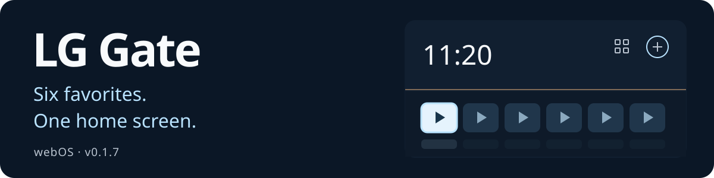

# LG Gate

<p align="center">
  <a href="README.md"></a>
  <a href="README.en.md"></a>
  <a href="README.zh-CN.md"></a>
  <a href="README.ja.md"></a>
  <a href="README.de.md"></a>
</p>

<p align="center">
  
</p>

A home screen for LG webOS with six favorite apps, remote control navigation, and a choice of local wallpapers.

[**Download release 0.1.7**](https://github.com/Donkiton/Lg-WebOS-launcher/releases/tag/v0.1.7) · [Install from ZIP (Russian)](docs/QUICKSTART.md) · [Root USB tool (Russian)](docs/ROOTING.md) · [SHA256](https://github.com/Donkiton/Lg-WebOS-launcher/releases/download/v0.1.7/SHA256SUMS.txt)

> [!WARNING]
> **Tested only on LG SM8200PLA.**
> Firmware **05.40.97** · webOS **4.10.2 (generation 4.5)** · Homebrew Channel **0.7.3**.
>
> **Compatibility with other models and versions has not been confirmed.** Do not install the IPK or apply the scripts without a separate compatibility check.


Screenshots show browser previews with sample apps and the original Russian interface. On the TV, the launcher uses the TV's own app catalog.

## What's new in 0.1.7

Seven new wallpapers and a picker with thumbnails and live preview. The panel opens over the right side of the launcher, keeping the clock and app cards in place and at their original size. This build was installed on LG SM8200PLA; all 35 application files were verified with SHA256.

## Features

- **Home screen:** up to six app cards that you can pin, replace, and reorder.
- **App catalog:** apps installed on the TV and supported Media Station X shortcuts.
- **Return home:** Home button integration, startup launch, and return after fully exiting an app.
- **App buttons:** separately configure IVI → YouTube and Movies/Rakuten → Zona.
- **Wi-Fi, added in 0.1.5:** opens LG's native network list; choose a network and enter its password in the TV settings.
- **Appearance:** 12 local wallpapers, a black background, animations, surface-aware reflections, and dimming.

## Choose your background

In **Settings → Wallpaper**, use the arrow keys to preview a background, **OK** to save it, and **Back** to restore the saved background. A light border marks focus; a checkmark marks the saved choice. The selection survives restarts; backgrounds do not change automatically with the time of day. The five earlier wallpapers are in the **Classic** tab; **No wallpaper** gives you a black screen.


The seven new scenes are **Seashore**, **After the Rain**, **Japanese Garden**, **Obsidian**, **Orbit**, **Northern Lights**, and **New Year's Eve**. Images and thumbnails are bundled and work offline; the interface renders the app card reflections.

<details>
<summary>Earlier wallpapers and app catalog — screenshots from 0.1.4</summary>

| Morning | Day |
| :---: | :---: |
|  |  |

| Evening | Night |
| :---: | :---: |
|  |  |


</details>

## Remote controls

| Button | Action |
| --- | --- |
| Arrow keys | Move focus |
| OK | Launch the selected app |
| Blue button | Open app card actions |
| Back | Go back |

## Install on your TV

**Root access and Homebrew Channel are required.** The release includes a ready-to-install IPK and an installer ZIP. The original DejaVuln Autoroot 0.0.10 USB archive is a separate asset; check [compatibility and rooting instructions (Russian)](docs/ROOTING.md) before using it. Start with the [ZIP installation guide (Russian)](docs/QUICKSTART.md); no source build is needed.

Check your model and versions against the configuration above, download the IPK, and follow the [step-by-step guide (Russian)](docs/INSTALLATION.md): install → assign Home → enable startup launch. The guide also covers button configuration and rollback. After a cold boot, Live TV may still appear before the launcher.

## Preview on your computer

Requires **Node.js 18+**.

```powershell
git clone https://github.com/Donkiton/Lg-WebOS-launcher.git
cd Lg-WebOS-launcher
npm start
```

Open **<http://127.0.0.1:4173>**. App launches and network behavior are simulated in the preview. The installed TV launcher runs without a server on your computer.

More documentation, in Russian: [installation, build, and rollback](docs/INSTALLATION.md) · [technical notes](docs/DEVELOPMENT.md) · [design history](DESIGN.md).

## License

The author and copyright holder of the original LG Gate materials is **Битюцкий Вадим Алексеевич (DonKiton)**. The project is distributed under the proprietary **LG Gate Proprietary Source License v1.1**.

Individuals may use, study, modify, and share the Software free of charge for personal, non-commercial purposes, subject to the license. Shared copies must retain the complete license and attribution notices, identify the copy or modification as unofficial, describe material changes and their author, and include the corresponding source code when binaries are distributed. **Commercial Use and Organizational Use require prior written permission and a separate license agreement**, including for modified versions.

See [LICENSE](LICENSE) for the full terms. Permission requests: [menfise@mail.ru](mailto:menfise@mail.ru). Third-party components and materials retain their own licenses and their respective owners' rights.
