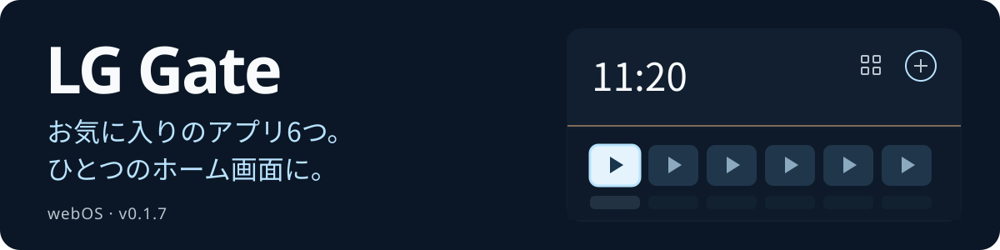

# LG Gate

<p align="center">
  <a href="README.md"></a>
  <a href="README.en.md"></a>
  <a href="README.zh-CN.md"></a>
  <a href="README.ja.md"></a>
  <a href="README.de.md"></a>
</p>

<p align="center">
  
</p>

LG webOS 向けのホーム画面。お気に入りのアプリ6つを並べ、リモコンで操作でき、ローカルの壁紙も選べます。

[**リリース 0.1.7 をダウンロード**](https://github.com/Donkiton/Lg-WebOS-launcher/releases/tag/v0.1.7) · [ZIP からインストール（ロシア語）](docs/QUICKSTART.md) · [root 用 USB ツール（ロシア語）](docs/ROOTING.md) · [SHA256](https://github.com/Donkiton/Lg-WebOS-launcher/releases/download/v0.1.7/SHA256SUMS.txt)

> [!WARNING]
> **動作確認済みの機種は LG SM8200PLA のみです。**
> ファームウェア **05.40.97** · webOS **4.10.2（4.5 世代）** · Homebrew Channel **0.7.3**。
>
> **他の機種やバージョンとの互換性は確認されていません。** 個別に互換性を確認するまでは、IPK のインストールやスクリプトの適用を行わないでください。


スクリーンショットは、サンプルアプリと元のロシア語 UI を使ったブラウザプレビューです。テレビ上では、そのテレビのアプリ一覧を使用します。

## 0.1.7 の新機能

7種類の新しい壁紙と、サムネイル・ライブプレビュー付きの選択パネルを追加しました。パネルはランチャーの右側に重なって開き、時計やアプリカードの位置とサイズは変わりません。このビルドは LG SM8200PLA にインストール済みで、アプリを構成する全35ファイルを SHA256 で検証しています。

## 主な機能

- **ホーム画面：** 最大6つのアプリカードを固定・入れ替え・並べ替えできます。
- **アプリ一覧：** テレビにインストールされたアプリと、対応する Media Station X のショートカットを表示します。
- **ホームに戻る：** Home ボタン、起動時の自動起動、アプリを完全に終了した後のホーム復帰に対応します。
- **アプリ専用ボタン：** IVI → YouTube と Movies/Rakuten → Zona を個別に設定できます。
- **Wi-Fi（0.1.5 で追加）：** LG 標準のネットワーク一覧を開きます。ネットワークの選択とパスワード入力はテレビの設定画面で行います。
- **外観：** 12種類のローカル壁紙、黒一色の背景、アニメーション、背景の材質に合わせた反射表現、減光に対応します。

## 壁紙を選ぶ

**設定 → 壁紙**で、方向キーを使って一時的にプレビューし、**OK** で保存、**Back** で保存済みの壁紙に戻します。明るい枠はフォーカス、チェックマークは保存済みの項目を示します。選択は再起動後も保持され、時刻による自動切り替えはありません。従来の5種類は**クラシック**タブにあり、**壁紙なし**を選ぶと黒一色の背景になります。


新しい7つのシーンは、**海辺**、**雨上がり**、**日本庭園**、**黒曜石**、**軌道**、**オーロラ**、**大晦日**です。画像とサムネイルはパッケージに含まれ、オフラインで使えます。アプリカードの反射は UI が描画します。

<details>
<summary>従来の壁紙とアプリ一覧 — 0.1.4 のスクリーンショット</summary>

| 朝 | 昼 |
| :---: | :---: |
|  |  |

| 夕方 | 夜 |
| :---: | :---: |
|  |  |


</details>

## リモコン操作

| ボタン | 操作 |
| --- | --- |
| 方向キー | フォーカスを移動 |
| OK | 選択したアプリを起動 |
| 青ボタン | カードの操作メニューを開く |
| Back | 戻る |

## テレビにインストールする

**root 権限と Homebrew Channel が必要です。** リリースにはビルド済み IPK とインストール用 ZIP が含まれ、ソースのビルドは不要です。オリジナルの DejaVuln Autoroot 0.0.10 USB アーカイブは別の添付ファイルです。使用前に[互換性と root の手順（ロシア語）](docs/ROOTING.md)を確認し、[ZIP インストールガイド（ロシア語）](docs/QUICKSTART.md)から始めてください。

機種とバージョンが上記の構成と一致することを確認し、IPK をダウンロードして、[手順書（ロシア語）](docs/INSTALLATION.md)に従ってください：インストール → Home の割り当て → 自動起動の有効化。ボタンの設定と元に戻す手順も同じ文書にあります。コールドブート後は、ランチャーの前に Live TV が表示される場合があります。

## パソコンでプレビューする

**Node.js 18+** が必要です。

```powershell
git clone https://github.com/Donkiton/Lg-WebOS-launcher.git
cd Lg-WebOS-launcher
npm start
```

**<http://127.0.0.1:4173>** を開いてください。プレビューではアプリの起動とネットワークの動作をシミュレートします。テレビにインストールしたランチャーは、パソコン上のサーバーなしで動作します。

関連文書（ロシア語）：[インストール・ビルド・元に戻す手順](docs/INSTALLATION.md) · [技術メモ](docs/DEVELOPMENT.md) · [デザインの記録](DESIGN.md)。
