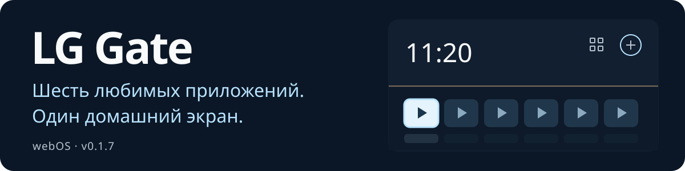

# LG Gate

<p align="center">
  <a href="README.md"></a>
  <a href="README.ru.md"></a>
  <a href="README.zh-CN.md"></a>
  <a href="README.ja.md"></a>
  <a href="README.de.md"></a>
</p>

<p align="center">
  
</p>

Домашний экран для LG webOS: шесть любимых приложений, управление пультом и выбор локального фона.

[**Скачать 0.1.7**](dist/org.lggate.launcher_0.1.7_all.ipk?raw=true) · [Установка и откат](docs/INSTALLATION.md) · [SHA256](dist/SHA256SUMS.txt)

> [!WARNING]
> **Проверено только на LG SM8200PLA.**
> ПО **05.40.97** · webOS **4.10.2 (поколение 4.5)** · Homebrew Channel **0.7.3**.
>
> **Для других моделей и версий совместимость не подтверждена.** Не устанавливайте IPK и не применяйте скрипты без отдельной проверки совместимости.


Скриншоты — из браузерного предпросмотра с общими примерами и русским интерфейсом. На ТВ используется его собственный каталог.

## Новое в 0.1.7

Семь новых фонов и меню с миниатюрами и предпросмотром. Панель открывается справа поверх лаунчера, сохраняя размер и положение часов и карточек. Сборка установлена на LG SM8200PLA; все 35 файлов приложения проверены по SHA256.

## Возможности

- **Главный экран:** до шести карточек с закреплением, заменой и перестановкой.
- **Каталог:** приложения телевизора и поддерживаемые ярлыки Media Station X.
- **Возврат домой:** Home, автозапуск и возврат после окончательного выхода из приложения.
- **Кнопки приложений:** отдельная настройка IVI → YouTube и Movies/Rakuten → Zona.
- **Wi-Fi, добавлен в 0.1.5:** кнопка открывает штатный список сетей LG; выбор сети и ввод пароля выполняются в настройках телевизора.
- **Оформление:** 12 локальных фонов, чёрный экран, анимации, отражения с учётом поверхности и затемнение.

## Выбор фона

В **«Настройки → Фон»** стрелки меняют временный предпросмотр, **OK** сохраняет выбор, **Back** возвращает установленный фон. Светлая рамка обозначает фокус, галочка — сохранённый вариант. Выбор сохраняется после перезапуска; автоматической смены по времени нет. Прежние пять фонов доступны во вкладке **«Классические»**, пункт **«Без фона»** включает чёрный экран.


Семь новых сцен: **«Морской берег»**, **«После дождя»**, **«Японский сад»**, **«Обсидиан»**, **«Орбита»**, **«Северное сияние»** и **«Новогодний вечер»**. Изображения и миниатюры входят в пакет и работают без сети; отражения карточек формирует интерфейс.

<details>
<summary>Прежние фоны и каталог — скриншоты 0.1.4</summary>

| Утро | День |
| :---: | :---: |
|  |  |

| Вечер | Ночь |
| :---: | :---: |
|  |  |


</details>

## Управление пультом

| Кнопка | Действие |
| --- | --- |
| Стрелки | Навигация |
| OK | Запуск выбранного приложения |
| Синяя кнопка | Действия с карточкой |
| Back | Назад |

## Установка на ТВ

Нужны **root-доступ и Homebrew Channel**. Получение root в комплект не входит.

Сверь модель и версии выше, скачай IPK и следуй [пошаговой инструкции](docs/INSTALLATION.md): установка → назначение Home → автозапуск. Там же — настройка кнопок и откат. После холодного старта перед лаунчером пока может появляться Live TV.

## Предпросмотр на ПК

Нужен **Node.js 18+**.

```powershell
git clone https://github.com/Donkiton/Lg-WebOS-launcher.git
cd Lg-WebOS-launcher
npm start
```

Открой **<http://127.0.0.1:4173>**. Запуск приложений и сеть здесь имитируются. Установленный лаунчер работает без сервера на ПК.

[Установка, сборка и откат](docs/INSTALLATION.md) · [Технические заметки](docs/DEVELOPMENT.md) · [История дизайна](DESIGN.md).
