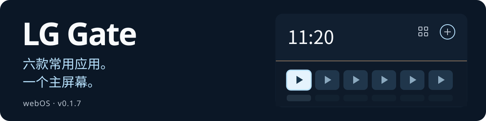
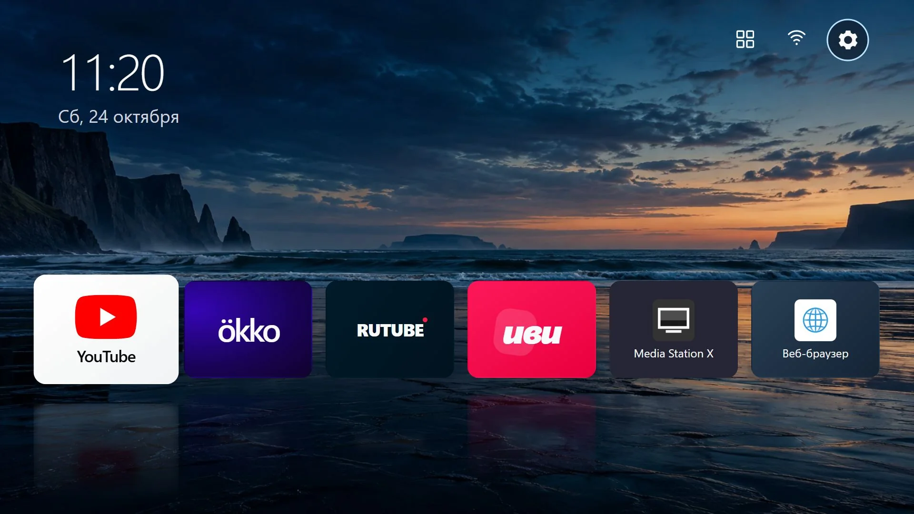
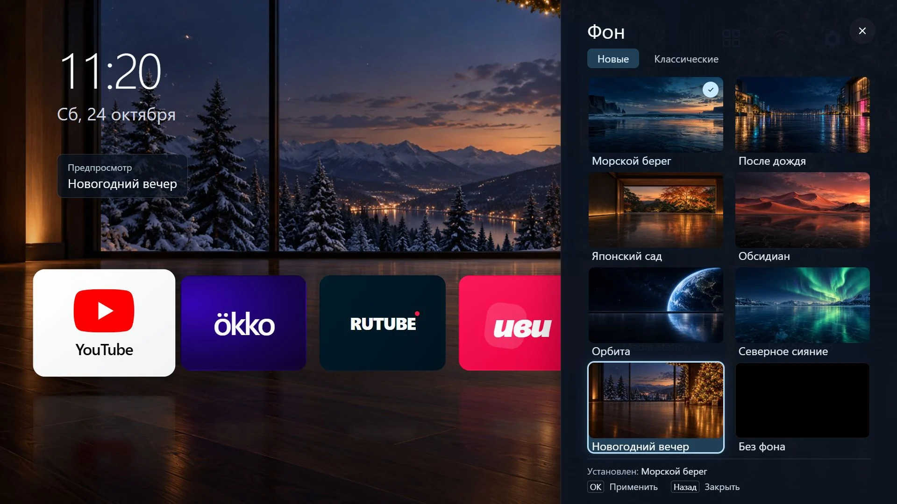
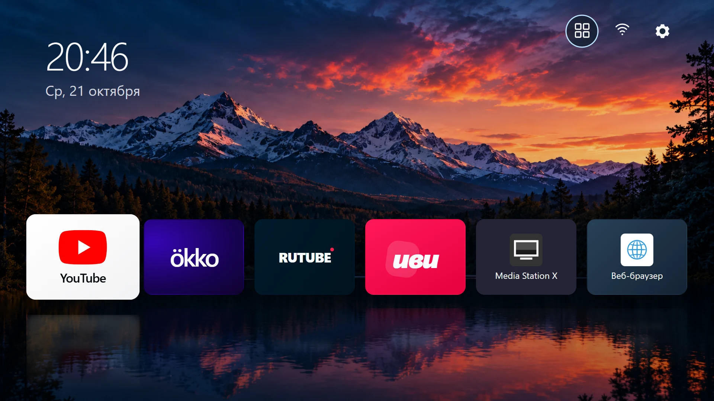
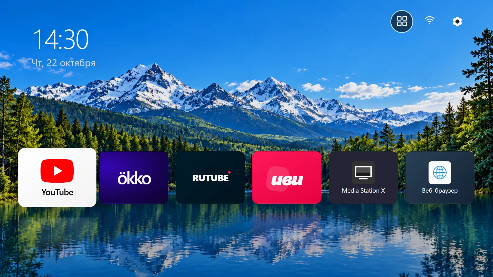
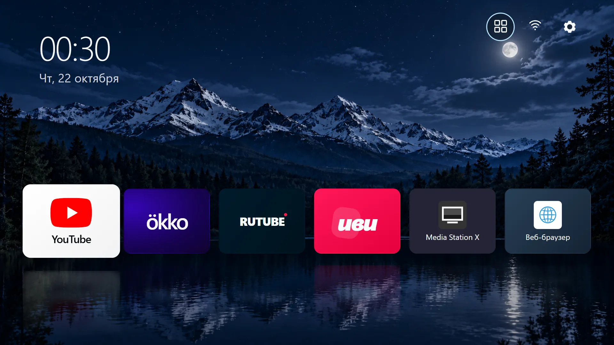
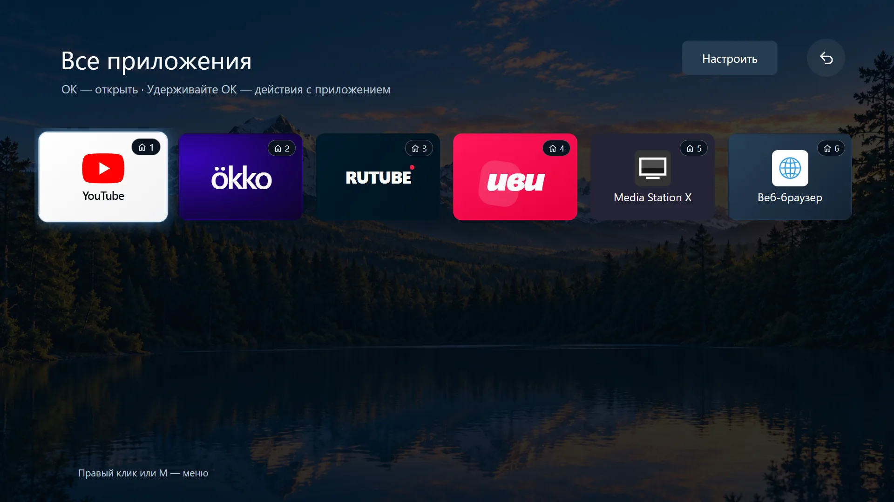

# LG Gate

<p align="center">
  <a href="README.ru.md"></a>
  <a href="README.md"></a>
  <a href="README.zh-CN.md"></a>
  <a href="README.ja.md"></a>
  <a href="README.de.md"></a>
</p>

<p align="center">
  
</p>

适用于 LG webOS 的主屏幕：六款常用应用、遥控器导航，以及可自由选择的本地壁纸。

[**下载 0.1.7**](dist/org.lggate.launcher_0.1.7_all.ipk?raw=true) · [安装与回退（俄语）](docs/INSTALLATION.md) · [SHA256](dist/SHA256SUMS.txt)

> [!WARNING]
> **仅在 LG SM8200PLA 上通过测试。**
> 固件 **05.40.97** · webOS **4.10.2（4.5 代）** · Homebrew Channel **0.7.3**。
>
> **尚未确认与其他型号或版本的兼容性。** 未单独检查兼容性前，请勿安装 IPK 或运行相关脚本。



截图来自浏览器预览，使用示例应用和原有的俄语界面。在电视上，启动器会读取该电视自身的应用目录。

## 0.1.7 新增内容

新增七款壁纸，以及支持缩略图和实时预览的选择面板。面板覆盖在启动器右侧，时钟和应用卡片的大小与位置保持不变。此版本已安装到 LG SM8200PLA；全部 35 个应用文件均已通过 SHA256 校验。

## 功能

- **主屏幕：** 最多六张应用卡片，支持固定、替换和调整顺序。
- **应用目录：** 显示电视上安装的应用及支持的 Media Station X 快捷方式。
- **返回主屏幕：** 支持 Home 键、开机自动启动，以及彻底退出应用后返回启动器。
- **应用专用按键：** 可分别设置 IVI → YouTube 和 Movies/Rakuten → Zona。
- **Wi-Fi（0.1.5 新增）：** 打开 LG 原生网络列表；选择网络和输入密码均在电视设置中完成。
- **外观：** 12 款本地壁纸、纯黑背景、动画、随表面材质变化的倒影，以及调暗效果。

## 选择壁纸

在**设置 → 壁纸**中，使用方向键临时预览，按 **OK** 保存选择，按 **Back** 恢复已保存的壁纸。浅色边框表示当前焦点，勾号表示已保存的选项。重启后仍会保留选择；壁纸不会根据时间自动切换。原有的五款壁纸位于**经典**标签页；选择**无壁纸**即可使用纯黑背景。



七款新场景分别为**海岸**、**雨后**、**日式庭园**、**黑曜石**、**轨道**、**北极光**和**跨年夜**。图片与缩略图均包含在安装包中，可离线使用；应用卡片的倒影由界面渲染。

<details>
<summary>早期壁纸与应用目录 — 0.1.4 版本截图</summary>

| 清晨 | 白天 |
| :---: | :---: |
|  |  |

| 傍晚 | 夜间 |
| :---: | :---: |
|  |  |



</details>

## 遥控器操作

| 按键 | 操作 |
| --- | --- |
| 方向键 | 移动焦点 |
| OK | 启动选中的应用 |
| 蓝色按键 | 打开卡片操作菜单 |
| Back | 返回 |

## 安装到电视

需要 **root 权限和 Homebrew Channel**。本项目不提供获取 root 权限的工具。

确认电视型号和版本与上述配置一致后，下载 IPK，并按照[分步指南（俄语）](docs/INSTALLATION.md)操作：安装 → 设置 Home 键 → 启用开机自动启动。指南还介绍了按键设置和回退方法。冷启动后，在启动器出现前仍可能短暂显示 Live TV。

## 在电脑上预览

需要 **Node.js 18+**。

```powershell
git clone https://github.com/Donkiton/Lg-WebOS-launcher.git
cd Lg-WebOS-launcher
npm start
```

打开 **<http://127.0.0.1:4173>**。预览中的应用启动和网络行为均为模拟。安装到电视后，启动器无需电脑上的服务器即可运行。

更多文档（俄语）：[安装、构建与回退](docs/INSTALLATION.md) · [技术说明](docs/DEVELOPMENT.md) · [设计历程](DESIGN.md)。
